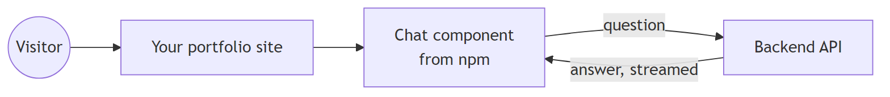
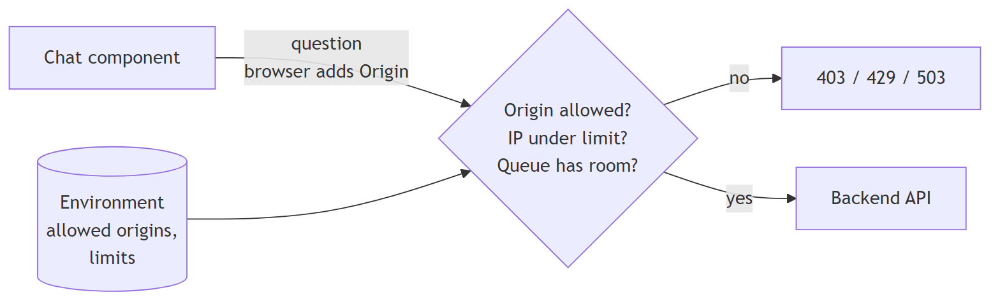
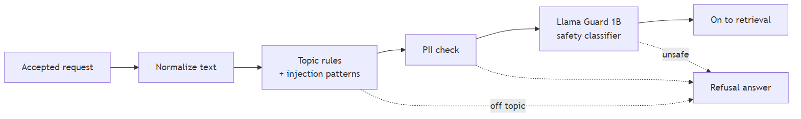
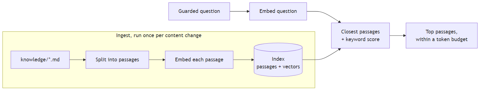
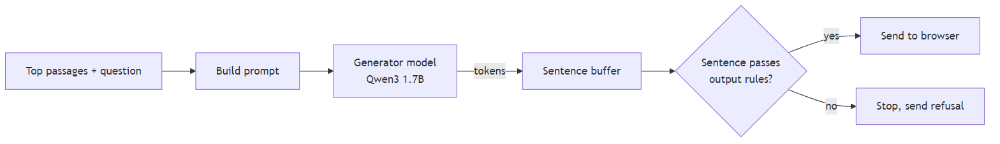
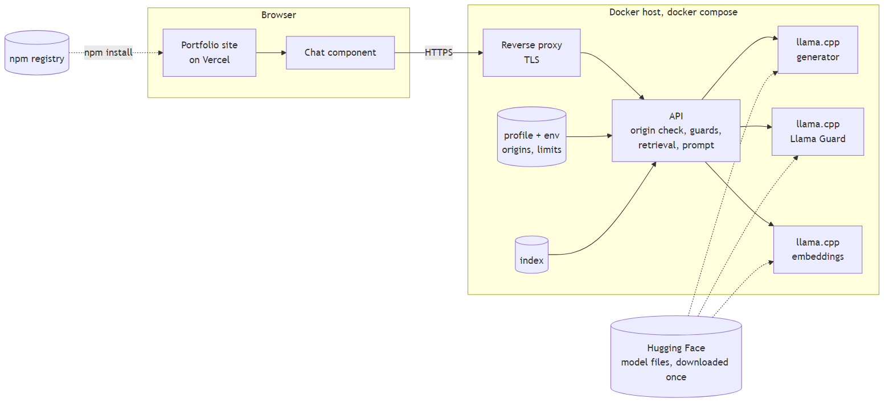
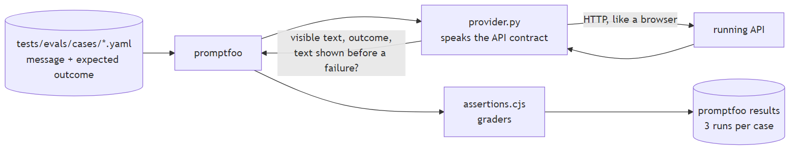
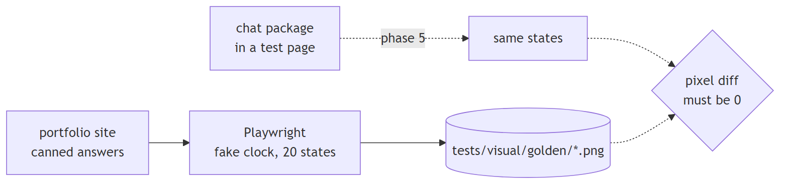
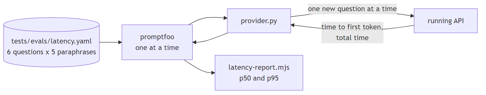

# System design

Vitae is a chat box on a website that answers questions using only a folder of documents you wrote. Three things make that work. The browser shows the chat. A backend decides whether a question is allowed and finds the relevant documents. A local language model writes the answer.

The diagrams below build the system up one piece at a time. Each one redraws the last and adds a single part. The images are generated from `diagrams/*.mmd` by `node docs/learn/render-diagrams.mjs`. Edit the `.mmd` file and rerun the script to change one.

## Step 1: a website talks to the backend

Someone visits your portfolio. The chat component, installed from npm, sends their question to the backend and streams the answer back.

## Step 2: the backend checks who is calling

Each owner runs their own backend for their own site, so the backend only needs to know which websites may call it. The browser attaches an `Origin` header to every request, saying which website the page came from. The backend accepts the request only if that origin is on the allowlist the owner set, the visitor's IP is under its rate limit, and the generation queue has room.

## Step 3: the question passes through input guards

Each guard either lets the question through or turns it into a polite refusal. The order matters. Cheap checks run first so the expensive model check only sees questions that survived.

## Step 4: retrieval finds the relevant passages

Before any visitor arrives, an ingest step splits your documents into short passages and turns each one into an embedding. An embedding is a list of numbers that captures what the passage means. At question time, the backend embeds the question the same way and picks the passages whose numbers are closest.

## Step 5: the model answers, and each sentence is checked before release

The backend builds a prompt from the question and the top passages. The model streams tokens back. The backend holds them until a sentence is complete, checks that sentence, and only then sends it to the browser.

On a CPU, the model's work comes in two steps. First it reads the whole prompt. Then it writes the answer one token at a time. The visitor sees nothing until the prompt is read and the first sentence is complete. A longer prompt means a longer wait, so the token budget for retrieved passages is the main control on how fast the first words appear. Every stage that runs before generation, such as the Llama Guard check and the embedding lookup, adds to that wait too. Later phases measure each one.

## Step 6: everything together, as containers

On the server, `docker compose` runs each piece as its own container. Only the reverse proxy is reachable from the internet. The three model servers are separate llama.cpp processes because each one loads a different model file.

## How the system is checked

Three checks talk to the real thing from the outside, the way a visitor would. They were built first, so every later phase can be checked against them. Behavior that is purely about HTTP, such as the origin check, message size, rate limits and the queue, is tested separately by integration tests that live next to the backend code.

The eval suite in `tests/evals/` runs on promptfoo, an open-source eval tool. Each case in `tests/evals/cases/*.yaml` is a message plus the outcomes that count as a pass, such as `answered`, `refused:pii` or `refused:injection`. Some cases also list facts the answer must mention, or strings it must never contain. The cases come from what the design says each guard must do. A small provider file sends each message to the running backend and reports what a visitor saw: the text, the outcome, and whether any text appeared before a refusal. Shared graders in `assertions.cjs` check that report. Every case runs three times, because the model does not answer the same way every time, and a case passes only if all three runs pass. `npm run evals` runs it, and `npm run evals:view` opens promptfoo's local results viewer.

The reference screenshots in `tests/visual/golden/` come from the portfolio's chat module, which answers with canned text when no backend is set. Playwright captures 20 states: desktop and mobile, light and dark, and for each of those an empty chat, a typing indicator, one exchange, two exchanges, and three exchanges. At three exchanges the chat has reached its maximum height and shows its scrollbar on the right. Playwright hides scrollbars by default, so the script turns that off. A fake clock holds the canned answer's timer, so the typing state stays put. A second capture matched the first pixel for pixel. The chat package is captured the same way in the UI phase and must match with zero differing pixels, anti-aliased edges included. Capturing new references prints the portfolio commit they came from, for the commit message.

The latency probe is a second promptfoo config, `tests/evals/latency.yaml`, using the same provider. It sends six questions, each in five paraphrases, one at a time and round-robin. Sending the same question twice would measure llama.cpp's prompt cache instead of a new visitor, because the server would skip reading a prompt it has already seen. `latency-report.mjs` turns the run into time to first token and total time at p50 and p95.

## Where each concept is explained further

`01-concepts.md` has short diagram walkthroughs of the origin allowlist, chunking, embeddings, npm packages and Hugging Face. Each phase then adds a deeper doc:

- The origin allowlist, CORS and rate limits: `02-access.md`, written in the contract phase.
- The guard pipeline: `03-guardrails.md`, written in the backend phase.
- Chunking, embeddings and retrieval: `04-retrieval.md`, written in the retrieval phase.
- Containers and compose: `05-orchestration.md`, written in the orchestration phase.
- Packaging and publishing the chat component: `06-npm-package.md`, written in the UI phase.
