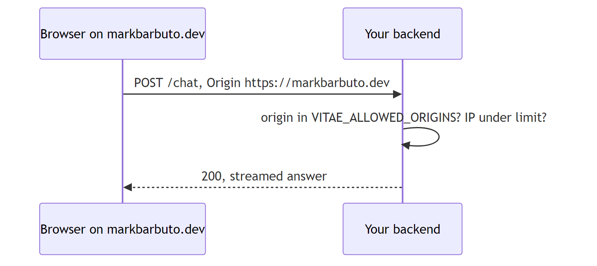
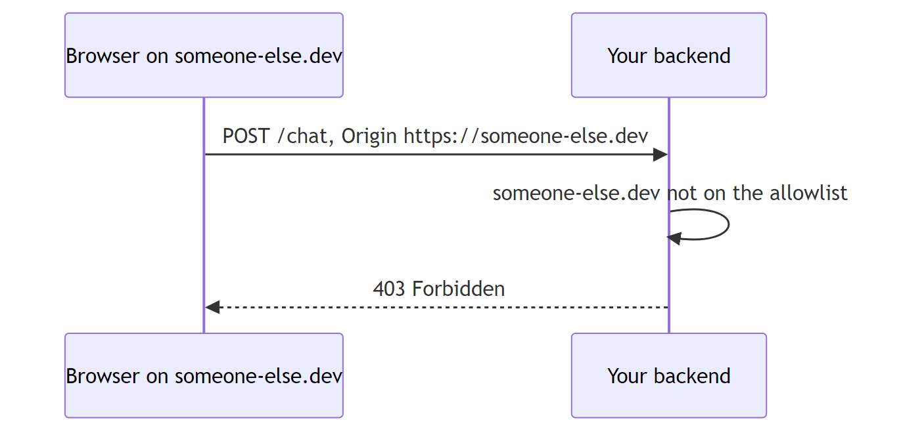
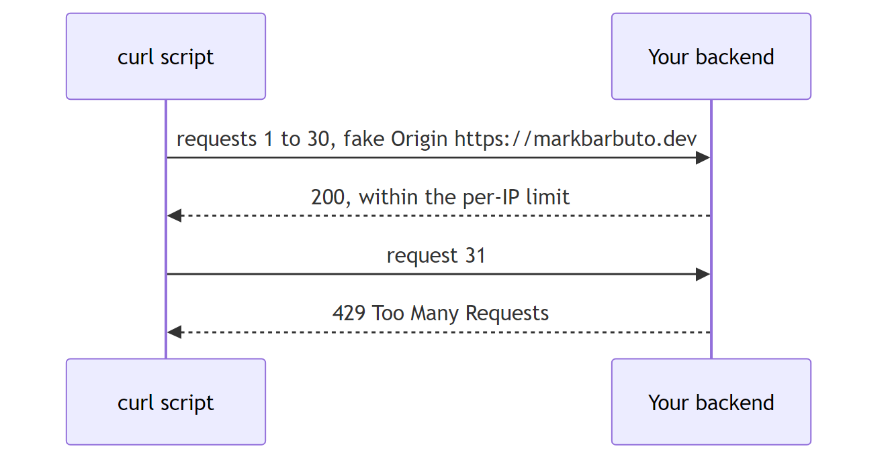
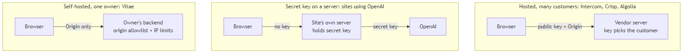
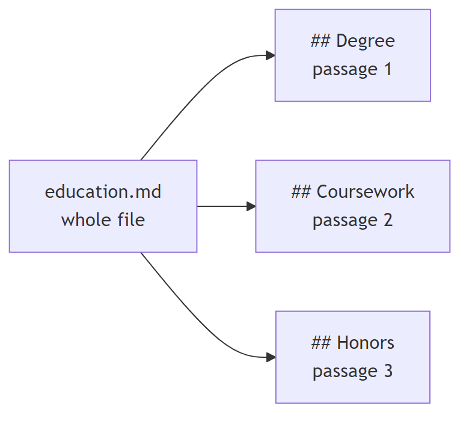
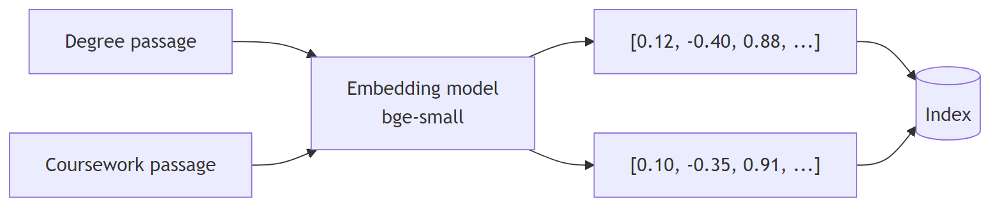
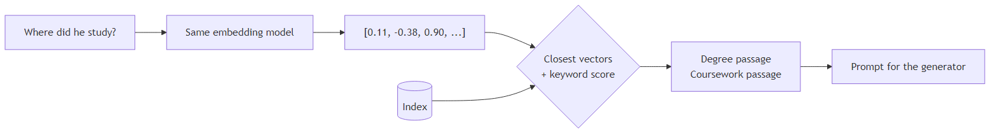
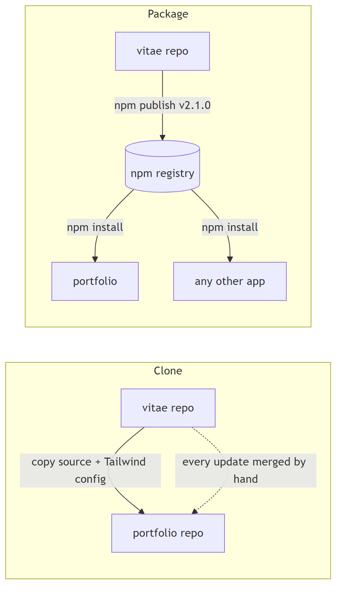
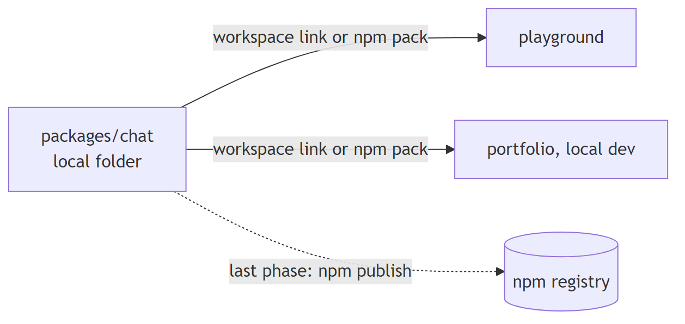
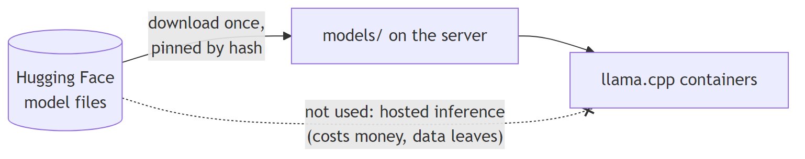

# Concepts behind the design

## Origin allowlist

The browser adds the `Origin` header itself. Page JavaScript cannot change it. The backend compares it with the list the owner set in `VITAE_ALLOWED_ORIGINS`.

Another website's page is rejected, because its browser reports its own origin.

A script outside a browser can fake the origin. Per-IP rate limits are what stop it.

## How other public chatbots handle access

Hosted services need a public key because one server serves many customers, and the key says which customer a request belongs to. Vitae runs one backend per owner, so there is nothing for a key to select. The origin allowlist does the same job without one.

## Chunking

## Embeddings

Each passage becomes a list of numbers. Passages with similar meaning get similar numbers.

## Search at question time

## Cloning versus an npm package

During development nothing is published. The portfolio links to the local package folder.

## Where Hugging Face fits

