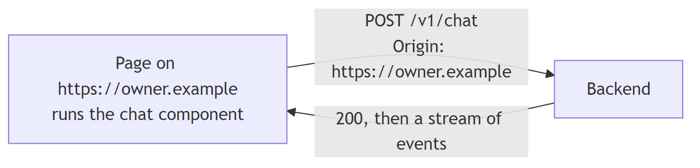
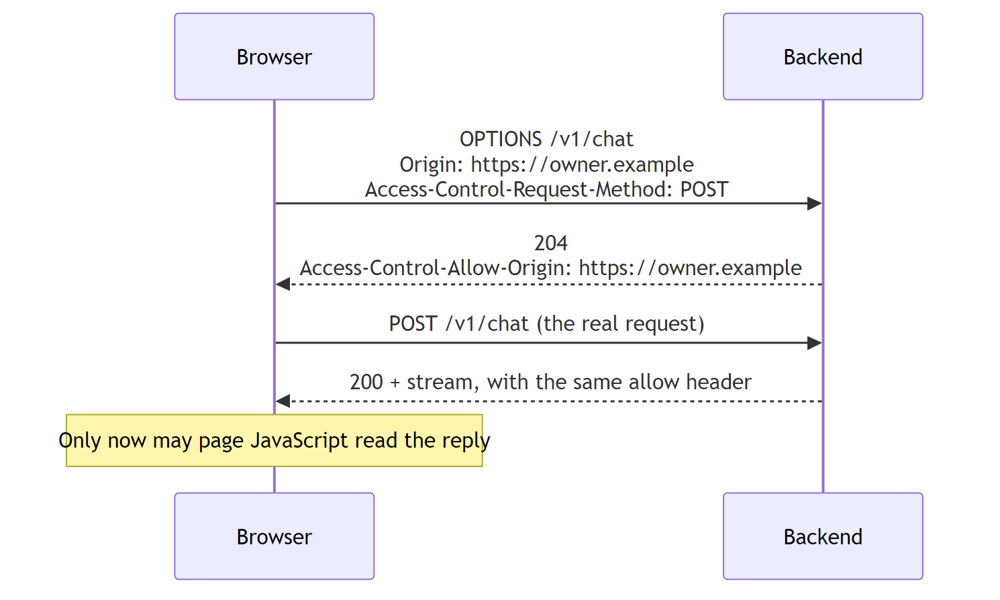
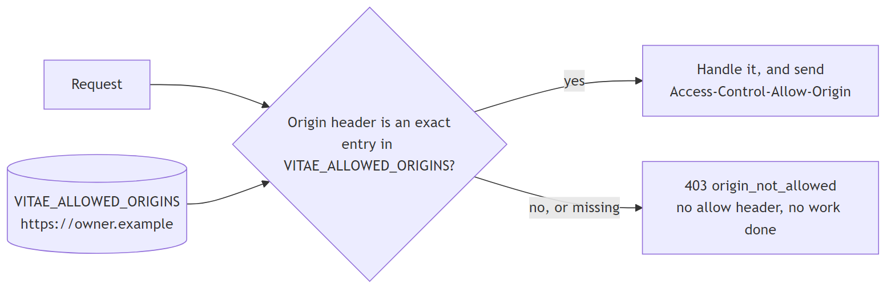
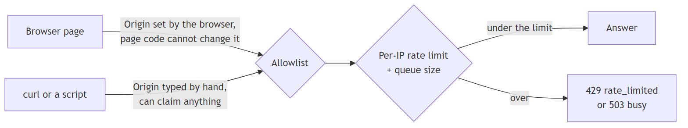
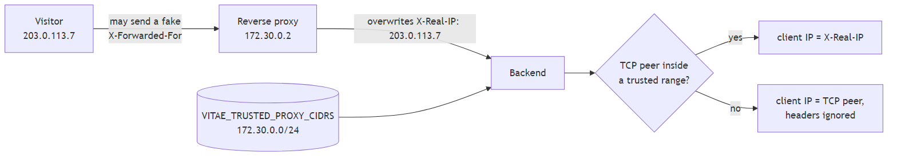
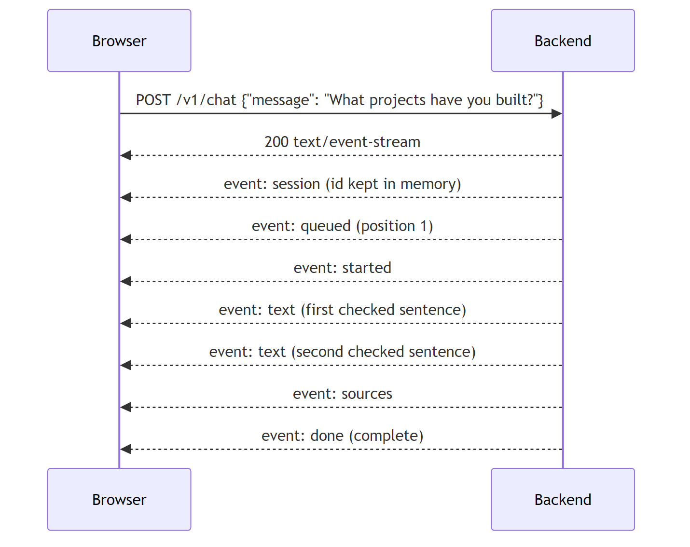

# Access: who may call the backend, and how answers come back

This doc covers the contract phase. It explains how a page on your site talks to the backend, how the backend decides whether to serve it, and why there is no API key. The contract itself lives in `backend/src/vitae/contract.py`. The generated copies other code reads live in `contract/`.

## A request from your site

The chat component runs inside a page on your site, say `https://owner.example`. When a visitor asks a question, the component sends a `POST` to `/v1/chat` on your backend. The browser adds an `Origin` header to that request. It names the site the page came from: scheme, host and port, nothing else.



The browser sets `Origin` itself. Page JavaScript cannot change or remove it, because browsers treat it as a forbidden header. So for a request that really comes from a browser, `Origin` tells the backend which site's page sent it.

## CORS and the preflight

Browsers do not let a page read a response from another site unless that site says so. This rule is called CORS, short for cross-origin resource sharing. Your page lives on `owner.example` and your backend lives somewhere else, for example `chat.owner.example`, so every chat request is cross-origin.

Because the request body is JSON, the browser first sends a small `OPTIONS` request, called a preflight. It asks the backend whether this origin may send a `POST`. The backend answers with `Access-Control-Allow-Origin: https://owner.example` only if that origin is allowed. Then the browser sends the real request, and lets the page read the reply only if the same header comes back.



CORS is enforced by the browser, not the server. A server that only sets CORS headers still does the full work for every request, and only a browser hides the result. So CORS alone protects nothing.

## The allowlist does the real check

Vitae checks the origin on the server before doing any work. The owner lists their sites in `VITAE_ALLOWED_ORIGINS`. The backend compares the request's `Origin` header with that list as an exact string match. If it is missing or not on the list, the backend answers `403 origin_not_allowed` and stops.



The match is exact on purpose. `https://*.vercel.app` would let anyone who deploys a page to Vercel call your backend, because anyone can deploy there. A lookalike such as `http://localhost:5173.attacker.example` is a different string, so it fails. When the settings load, each configured origin is checked and written in one standard form. A wildcard, a path, `null` or a typo stops the backend from starting, with a message that names the bad value.

A blocked request in a browser carries no allow header, so the page sees a network error and cannot read the 403 body. That is correct. Only curl, the evals and your browser's developer tools see the reason.

## Scripts can lie about Origin, so rate limits back it up

A script outside a browser can type any `Origin` header it likes. The allowlist stops other websites from using your backend through their visitors' browsers. It does not stop someone running curl in a loop. Per-IP rate limits and the generation queue do that.



`VITAE_RATE_LIMITS` lists windows such as `6/minute,60/hour,200/day`. A visitor over any window gets `429 rate_limited` with a `Retry-After` header. When every generation slot and queue place is taken, the next request gets `503 busy`. Both happen before the stream starts, so the page gets a real status code and can show the right message.

## Whose IP address is it?

A rate limit per IP needs the visitor's real IP. In production a reverse proxy sits in front of the backend and terminates TLS, so the backend's TCP connection comes from the proxy, not the visitor. Proxies pass the visitor's address in a header. But a visitor can also send that header, filled with any address, to get a fresh rate-limit allowance on every request.



Vitae trusts a header only when the TCP connection comes from a proxy the owner named in `VITAE_TRUSTED_PROXY_CIDRS`. The proxy must overwrite a single-value header, `X-Real-IP` by default, so whatever the visitor sent is replaced. With no trusted proxy configured, the backend uses the TCP address and ignores every forwarding header. `X-Forwarded-For` is refused as the client-IP header, because proxies append to it, and the first address in the list is whatever the visitor typed.

## Why there is no API key

Anything the browser runs, the visitor can read. A key in the chat component's code shows up in the page source, the network tab and the bundle. So a browser key cannot be a secret. Hosted chat services still use a "publishable" key, but only to say which customer's configuration a request belongs to, because one server serves many customers. Vitae runs one backend per owner, so there is nothing for a key to select. The origin allowlist already says which sites may call it, and the rate limits handle everything else. The component takes only `apiBaseUrl`.

## How the answer streams back

Once a request is accepted, the backend answers `200` with `Content-Type: text/event-stream`. This format is called Server-Sent Events, or SSE. The response stays open, and the backend writes one event at a time. Each event is two lines and a blank line:

```
event: text
data: {"type":"text","text":"I built Shift Notes, a handoff tool for support teams. "}
```

The browser's built-in `EventSource` only supports `GET`, and a chat request needs a JSON body. So the component uses `fetch` and reads the response body as a stream, splitting it on blank lines.



Every stream follows one order. `session` comes first and carries a session id the component keeps in memory only. `queued` and `started` may follow while the request waits for the model. Then come `text` events, each one a sentence that passed the output checks, then optionally `sources`. Exactly one terminal event ends the stream: `done`, `refused`, `availability` or `error`.

A refusal can only arrive before any text. If a later sentence fails the output checks, the backend drops it and ends with `done` and `finish: "withheld"`. The visitor sees an answer that stops at the last checked sentence. They never see text that later gets taken back.

## Errors before and after the stream

Before the `200` is sent, a problem gets a real HTTP status and a JSON body:

| Status | Code | Meaning |
|---|---|---|
| 400 | `invalid_request` | The body is not a valid chat request |
| 403 | `origin_not_allowed` | `Origin` is missing or not on the allowlist |
| 413 | `too_long` | The message is over 500 characters |
| 429 | `rate_limited` | This IP is over a rate limit window |
| 429 | `session_limit` | This conversation used all its turns |
| 503 | `busy` | Every generation slot and queue place is taken |
| 503 | `unavailable` | A model server or the index is down |

After the `200`, the status can no longer change, so a failure arrives as an `error` event. The UI shows a different message for each code. The same code names are what the evals grade, so `rejected:busy` in an eval case is exactly the `busy` the UI handles.

## One definition, three readers

The Pydantic models in `backend/src/vitae/contract.py` are the only place the contract is written by hand. `npm run contract` exports them to a JSON Schema, generates TypeScript types from that schema, and writes example streams to `contract/streams/`. The backend uses the models directly, the chat component will import the generated types, and the eval provider folds a stream into an outcome with the same Python code the tests use. CI regenerates everything and fails if the committed files differ, so the three readers cannot drift apart.
